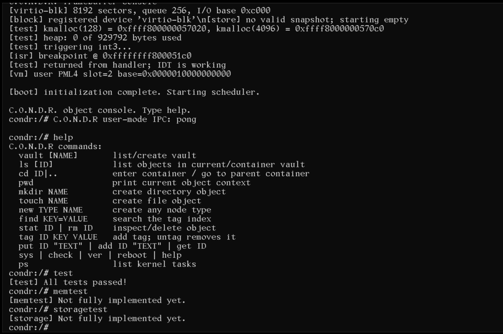

<p align="center">
  
</p>

<p align="center">
  <a href="https://github.com/Ghostoraner/C.O.N.D.R"></a>
  
  
  
  <a href="LICENSE"></a>
</p>
 
 
# C.O.N.D.R.

**Command Operating Node Data Router** is an experimental 64-bit x86 operating
system written in freestanding C++23 and NASM. It boots through Limine on BIOS
and UEFI systems.

> This is an early hobby OS, not a secure or production-ready system. The shell
> runs in kernel mode.

## Features

- Limine boot, x86_64 entry point, GDT, IDT and interrupt stubs

- Remapped 8259 PIC, 100 Hz PIT ticks and interrupt-driven PS/2 input queue

- Cooperative single-CPU kernel task scheduler with independent stacks (`nord::arch::scheduler`)

- Physical page allocator, kernel heap, and virtual memory management

- 32-bit Limine framebuffer with a 12x22 console font

- PS/2 keyboard input and framebuffer command console

- 32-bit `NodeId` (`u32`) architecture integrated across IPC, capability rights, and NVMFS storage handles

- Block device abstraction layer (`BlockDevice`) with VirtIO-blk driver registration

- Two-slot NVMFS snapshot mechanism with CRC persistence over block devices

- Kernel-level automated unit testing framework (`kernel/test/`) covering PMM, heap, address spaces, and scheduler status

- Freestanding command tokenizer with quoted arguments


## Build and run

Required tools: `g++` with C++23 support, `ld`, `nasm`, `make`, `git`,
`qemu-system-x86_64`, and either `xorriso` or `genisoimage`. A dedicated
`x86_64-elf` cross-compiler is recommended; the Makefile falls back to the
host compiler and linker.

```sh
make            # build/condr.elf
make iso        # build/condr.iso (clones Limine on first use)
make usb-iso    # build/condr-usb.iso, hybrid BIOS/UEFI image (requires xorriso)
make run        # boot C.O.N.D.R. in QEMU
make debug      # boot QEMU paused for GDB

```

Click the QEMU window to give the guest keyboard focus. `Ctrl+Alt+3` switches to
the COM1 serial console; `Ctrl+Alt+1` returns to the framebuffer. Press `Ctrl+C`
in the launching terminal to stop QEMU.

For USB writing instructions and firmware notes, see [docs/USB_BOOT.md](https://www.google.com/search?q=docs/USB_BOOT.md).
The upcoming kernel milestones are tracked in [docs/ROADMAP.md](https://www.google.com/search?q=docs/ROADMAP.md).

## NVMFS & Storage

NVMFS means **Node Vector Memory File System**. It is a flat registry of typed
objects, not a pathname-based filesystem. Each node has a 32-bit ID (`u32`), type, name,
optional container ID and a byte stream. Tags are stored in a separate fixed
index and queried by key/value. `vault` and `directory` nodes can contain other
objects, but there are no POSIX paths.

Persistence is handled via a two-slot snapshot mechanism with CRC validation utilizing the abstract `BlockDevice` layer (backed by VirtIO-blk).

## Console

The guest uses short, object-oriented commands rather than POSIX commands:

| Command | Action |
| --- | --- |
| `vault [NAME]` | List vaults or create one |
| `ls [ID]` | List the current container or a container ID |
| `cd ID`, `cd ..` | Enter a vault/directory object or return to its container |
| `pwd` | Show the current object context |
| `mkdir NAME`, `touch NAME` | Create directory/file objects in the current container |
| `new TYPE NAME` | Create a `file`, `directory`, `vault`, `device` or `process` node |
| `find KEY=VALUE` | Find objects through the tag index |
| `stat ID`, `rm ID` | Inspect or delete an object |
| `tag ID KEY VALUE`, `untag ID KEY VALUE` | Add or remove a tag |
| `put ID "TEXT"`, `add ID "TEXT"`, `get ID` | Replace, append or read a stream |
| `test` | Run automated kernel unit test suite |
| `memtest` | Execute memory and heap subsystem checks |
| `storagetest` | Test block device storage and snapshots |
| `sys`, `check`, `ver`, `reboot`, `help` | Status, self-test, version, reboot and help |
| `ps` | List kernel tasks and context-switch counts |

Example session on a fresh boot:

```text
vault research
cd 1
touch "boot notes"
ls
tag 2 topic kernel
find topic=kernel
put 2 "Limine enters the kernel"
get 2
stat 2
test
sys

```

IDs are monotonically assigned during each boot, so example IDs change after
creating or deleting objects. The tokenizer supports single and double quotes.

## Debugging

Run `make debug`, then in another terminal run:

```sh
./scripts/gdb-attach.sh

```
## Screenshots

<p align="center">
  
</p>
<p align="center">
  <em>Kernel initialization, VirtIO-blk registration, and console command execution.</em>
</p>

## License

The C.O.N.D.R. source code is offered under the MIT License; see `LICENSE`.
The embedded `LatGrkCyr-12x22` console font is a separate third-party asset
licensed under GPL-2.0. Its source and attribution are documented in
`THIRD_PARTY_NOTICES.md`.

See [CONTRIBUTING.md](CONTRIBUTING.md) for contribution guidelines and
[SECURITY.md](SECURITY.md) for vulnerability reporting.

[](https://gitdiagram.com/ghostoraner/c.o.n.d.r?utm_source=readme&utm_medium=picture)

---

# C.O.N.D.R. (Русский)

**Command Operating Node Data Router** — экспериментальная 64-битная ОС для
x86, написанная на freestanding C++23 и NASM. Загружается через Limine в BIOS
и UEFI.

> Это ранний hobby-проект, не предназначенный для безопасной или промышленной
> эксплуатации. Shell работает в режиме ядра.

## Возможности

* Загрузка Limine, точка входа x86_64, GDT, IDT и обработчики прерываний
* Переназначенный PIC 8259, тики PIT 100 Гц и очередь ввода PS/2 через IRQ
* Кооперативный однопроцессорный планировщик задач ядра с отдельными стеками (`nord::arch::scheduler`)
* Физический аллокатор страниц, куча ядра и управление виртуальной памятью
* Framebuffer Limine 32 bpp со шрифтом консоли 12x22
* Ввод с PS/2-клавиатуры и графическая командная консоль
* Архитектура 32-битных `NodeId` (`u32`), интегрированная в IPC, права возможностей и хранилище NVMFS
* Абстракция блочных устройств (`BlockDevice`) с регистрацией драйвера VirtIO-blk
* Двухслотовый механизм снапшотов NVMFS с защитой CRC поверх блочного слоя
* Модуль автоматического юнит-тестирования ядра (`kernel/test/`) для PMM, кучи, адресных пространств и планировщика
* Freestanding-токенизатор команд с поддержкой аргументов в кавычках

## Сборка и запуск

Нужны `g++` с поддержкой C++23, `ld`, `nasm`, `make`, `git`,
`qemu-system-x86_64` и `xorriso` либо `genisoimage`. Рекомендуется отдельный
кросс-компилятор `x86_64-elf`; Makefile умеет использовать host compiler/linker.

```sh
make            # сборка build/condr.elf
make iso        # сборка build/condr.iso (при первом запуске клонируется Limine)
make usb-iso    # сборка build/condr-usb.iso, hybrid BIOS/UEFI (нужен xorriso)
make run        # запуск C.O.N.D.R. в QEMU
make debug      # запуск QEMU с паузой для GDB

```

Щёлкни по окну QEMU, чтобы передать клавиатуру гостевой системе. `Ctrl+Alt+3`
переключает на serial-консоль COM1, `Ctrl+Alt+1` возвращает framebuffer.
Остановить QEMU можно через `Ctrl+C` в терминале запуска.

Инструкция по записи на USB и примечания по прошивкам: [docs/USB_BOOT.md](https://www.google.com/search?q=docs/USB_BOOT.md).
Следующие этапы разработки ядра: [docs/ROADMAP.md](https://www.google.com/search?q=docs/ROADMAP.md).

## NVMFS и Хранилище

NVMFS расшифровывается как **Node Vector Memory File System**. Это плоский
реестр типизированных объектов, а не файловая система с путями. У узла есть
32-битный ID (`u32`), тип, имя, необязательный ID контейнера и поток байтов. Теги
хранятся в отдельном фиксированном индексе и ищутся по паре ключ/значение.
Узлы `vault` и `directory` могут содержать другие объекты, но POSIX-путей нет.

Персистентность обеспечивается двухслотовым механизмом снапшотов с проверкой CRC через абстракцию `BlockDevice` (на базе VirtIO-blk).

## Командная консоль

Используются короткие объектные команды, а не POSIX-команды:

| Команда | Действие |
| --- | --- |
| `vault [NAME]` | Показать vault-объекты или создать vault |
| `ls [ID]` | Показать объекты текущего контейнера или указанного ID |
| `cd ID`, `cd ..` | Войти в vault/directory или вернуться в контейнер-родитель |
| `pwd` | Показать текущий контекст объектов |
| `mkdir NAME`, `touch NAME` | Создать directory/file-объект в текущем контейнере |
| `new TYPE NAME` | Создать узел типа `file`, `directory`, `vault`, `device` или `process` |
| `find KEY=VALUE` | Найти объекты через теговый индекс |
| `stat ID`, `rm ID` | Показать или удалить объект |
| `tag ID KEY VALUE`, `untag ID KEY VALUE` | Добавить или удалить тег |
| `put ID "TEXT"`, `add ID "TEXT"`, `get ID` | Заменить, дописать или прочитать поток |
| `test` | Запустить набор автоматических юнит-тестов ядра |
| `memtest` | Выполнить проверки подсистемы памяти и кучи |
| `storagetest` | Проверить блочное хранилище и снапшоты |
| `sys`, `check`, `ver`, `reboot`, `help` | Статус, самопроверка, версия, перезагрузка и помощь |
| `ps` | Список kernel-задач и число переключений контекста |

Пример с чистой загрузки:

```text
vault research
cd 1
touch "boot notes"
ls
tag 2 topic kernel
find topic=kernel
put 2 "Limine enters the kernel"
get 2
stat 2
test
sys

```

ID назначаются последовательно во время загрузки, поэтому примерные значения
меняются после создания или удаления объектов. Токенизатор поддерживает
одинарные и двойные кавычки.

## Отладка

Выполни `make debug`, затем в другом терминале:

```sh
./scripts/gdb-attach.sh

```
## Скриншоты

<p align="center">
  
</p>
<p align="center">
  <em>Инициализация ядра, регистрация VirtIO-blk и выполнение команд в консоли.</em>
</p>

## Лицензия

Исходный код C.O.N.D.R. распространяется по лицензии MIT; см. `LICENSE`.
Встроенный шрифт `LatGrkCyr-12x22` — отдельный сторонний ресурс под GPL-2.0.
Источник и атрибуция указаны в `THIRD_PARTY_NOTICES.md`.

Правила участия описаны в [CONTRIBUTING.md](CONTRIBUTING.md), а порядок
сообщения об уязвимостях — в [SECURITY.md](SECURITY.md).

[](https://gitdiagram.com/ghostoraner/c.o.n.d.r?utm_source=readme&utm_medium=picture)