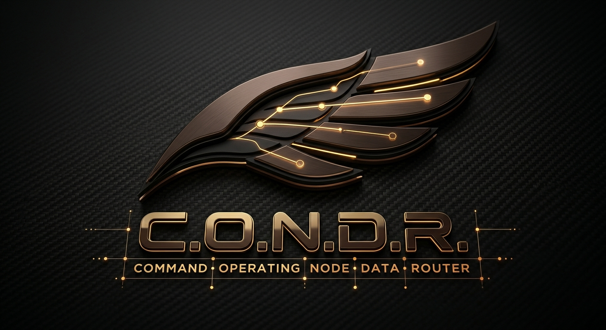

<p align="center">
  
</p>

<p align="center">
  <a href="https://github.com/Ghostoraner/C.O.N.D.R"></a>
  
  
  
  <a href="LICENSE"></a>
  [](https://gitdiagram.com/ghostoraner/c.o.n.d.r?utm_source=readme&utm_medium=badge)
</p>

# C.O.N.D.R.

**Command Operating Node Data Router** is an experimental 64-bit x86 operating
system written in freestanding C++23 and NASM. It boots through Limine on BIOS
and UEFI systems.

> This is an early hobby OS, not a secure or production-ready system. The shell
> runs in kernel mode and NVMFS is volatile memory storage.

## Features

- Limine boot, x86_64 entry point, GDT, IDT and interrupt stubs
- Remapped 8259 PIC, 100 Hz PIT ticks and interrupt-driven PS/2 input queue
- Cooperative single-CPU kernel task scheduler with independent stacks
- Physical page allocator and kernel heap
- 32-bit Limine framebuffer with a 12x22 console font
- PS/2 keyboard input and framebuffer command console
- NVMFS flat object registry with 64-bit IDs, containers, indexed tags and data streams
- Freestanding command tokenizer with quoted arguments

## Build and run

Required tools: `g++` with C++23 support, `ld`, `nasm`, `make`, `git`,
`qemu-system-x86_64`, and either `xorriso` or `genisoimage`. A dedicated
`x86_64-elf` cross-compiler is recommended; the Makefile falls back to the
host compiler and linker.

```sh
make            # build/condr.elf
make iso        # build/condr.iso (clones Limine on first use)
make usb-iso    # build/condr-usb.iso, hybrid BIOS/UEFI image (requires xorriso)
make run        # boot C.O.N.D.R. in QEMU
make debug      # boot QEMU paused for GDB
```

Click the QEMU window to give the guest keyboard focus. `Ctrl+Alt+3` switches to
the COM1 serial console; `Ctrl+Alt+1` returns to the framebuffer. Press `Ctrl+C`
in the launching terminal to stop QEMU.

For USB writing instructions and firmware notes, see [docs/USB_BOOT.md](docs/USB_BOOT.md).
The upcoming kernel milestones are tracked in [docs/ROADMAP.md](docs/ROADMAP.md).

## NVMFS

NVMFS means **Node Vector Memory File System**. It is a flat registry of typed
objects, not a pathname-based filesystem. Each node has a 64-bit ID, type, name,
optional container ID and a byte stream. Tags are stored in a separate fixed
index and queried by key/value. `vault` and `directory` nodes can contain other
objects, but there are no POSIX paths.

Current limits are 128 nodes, 512 tag-index entries, 256 KiB of stream data in
total and 32 KiB per stream. All contents are in RAM and disappear on reboot.

## Console

The guest uses short, object-oriented commands rather than POSIX commands:

| Command | Action |
|---|---|
| `vault [NAME]` | List vaults or create one |
| `ls [ID]` | List the current container or a container ID |
| `cd ID`, `cd ..` | Enter a vault/directory object or return to its container |
| `pwd` | Show the current object context |
| `mkdir NAME`, `touch NAME` | Create directory/file objects in the current container |
| `new TYPE NAME` | Create a `file`, `directory`, `vault`, `device` or `process` node |
| `find KEY=VALUE` | Find objects through the tag index |
| `stat ID`, `rm ID` | Inspect or delete an object |
| `tag ID KEY VALUE`, `untag ID KEY VALUE` | Add or remove a tag |
| `put ID "TEXT"`, `add ID "TEXT"`, `get ID` | Replace, append or read a stream |
| `sys`, `check`, `ver`, `reboot`, `help` | Status, self-test, version, reboot and help |
| `ps` | List kernel tasks and context-switch counts |

Example session on a fresh boot:

```text
vault research
cd 0x4e564d4600000001
touch "boot notes"
ls
tag 0x4e564d4600000002 topic kernel
find topic=kernel
put 0x4e564d4600000002 "Limine enters the kernel"
get 0x4e564d4600000002
stat 0x4e564d4600000002
sys
check
```

IDs are monotonically assigned during each boot, so example IDs change after
creating or deleting objects. The tokenizer supports single and double quotes.
`check` runs an NVMFS self-test covering node creation, tag lookup, stream
write/read and deletion.

## Debugging

Run `make debug`, then in another terminal run:

```sh
./scripts/gdb-attach.sh
```

## License

The C.O.N.D.R. source code is offered under the MIT License; see `LICENSE`.
The embedded `LatGrkCyr-12x22` console font is a separate third-party asset
licensed under GPL-2.0. Its source and attribution are documented in
`THIRD_PARTY_NOTICES.md`.

See [CONTRIBUTING.md](CONTRIBUTING.md) for contribution guidelines and
[SECURITY.md](SECURITY.md) for vulnerability reporting.

---

# C.O.N.D.R. (Русский)

**Command Operating Node Data Router** — экспериментальная 64-битная ОС для
x86, написанная на freestanding C++23 и NASM. Загружается через Limine в BIOS
и UEFI.

> Это ранний hobby-проект, не предназначенный для безопасной или промышленной
> эксплуатации. Shell работает в режиме ядра, а данные NVMFS хранятся только в RAM.

## Возможности

- Загрузка Limine, точка входа x86_64, GDT, IDT и обработчики прерываний
- Переназначенный PIC 8259, тики PIT 100 Гц и очередь ввода PS/2 через IRQ
- Кооперативный однопроцессорный scheduler kernel-задач с отдельными стеками
- Физический аллокатор страниц и heap ядра
- Framebuffer Limine 32 bpp со шрифтом консоли 12x22
- Ввод с PS/2-клавиатуры и графическая командная консоль
- Плоский реестр объектов NVMFS с 64-битными ID, контейнерами, тегами и потоками данных
- Freestanding-токенизатор команд с поддержкой аргументов в кавычках

## Сборка и запуск

Нужны `g++` с поддержкой C++23, `ld`, `nasm`, `make`, `git`,
`qemu-system-x86_64` и `xorriso` либо `genisoimage`. Рекомендуется отдельный
кросс-компилятор `x86_64-elf`; Makefile умеет использовать host compiler/linker.

```sh
make            # сборка build/condr.elf
make iso        # сборка build/condr.iso (при первом запуске клонируется Limine)
make usb-iso    # сборка build/condr-usb.iso, hybrid BIOS/UEFI (нужен xorriso)
make run        # запуск C.O.N.D.R. в QEMU
make debug      # запуск QEMU с паузой для GDB
```

Щёлкни по окну QEMU, чтобы передать клавиатуру гостевой системе. `Ctrl+Alt+3`
переключает на serial-консоль COM1, `Ctrl+Alt+1` возвращает framebuffer.
Остановить QEMU можно через `Ctrl+C` в терминале запуска.

Инструкция по записи на USB и примечания по прошивкам: [docs/USB_BOOT.md](docs/USB_BOOT.md).
Следующие этапы разработки ядра: [docs/ROADMAP.md](docs/ROADMAP.md).

## NVMFS

NVMFS расшифровывается как **Node Vector Memory File System**. Это плоский
реестр типизированных объектов, а не файловая система с путями. У узла есть
64-битный ID, тип, имя, необязательный ID контейнера и поток байтов. Теги
хранятся в отдельном фиксированном индексе и ищутся по паре ключ/значение.
Узлы `vault` и `directory` могут содержать другие объекты, но POSIX-путей нет.

Текущие лимиты: 128 узлов, 512 записей тегового индекса, 256 KiB потоковых
данных суммарно и 32 KiB на поток. Всё содержимое находится в RAM и пропадает
после перезагрузки.

## Командная консоль

Используются короткие объектные команды, а не POSIX-команды:

| Команда | Действие |
|---|---|
| `vault [NAME]` | Показать vault-объекты или создать vault |
| `ls [ID]` | Показать объекты текущего контейнера или указанного ID |
| `cd ID`, `cd ..` | Войти в vault/directory или вернуться в контейнер-родитель |
| `pwd` | Показать текущий контекст объектов |
| `mkdir NAME`, `touch NAME` | Создать directory/file-объект в текущем контейнере |
| `new TYPE NAME` | Создать узел типа `file`, `directory`, `vault`, `device` или `process` |
| `find KEY=VALUE` | Найти объекты через теговый индекс |
| `stat ID`, `rm ID` | Показать или удалить объект |
| `tag ID KEY VALUE`, `untag ID KEY VALUE` | Добавить или удалить тег |
| `put ID "TEXT"`, `add ID "TEXT"`, `get ID` | Заменить, дописать или прочитать поток |
| `sys`, `check`, `ver`, `reboot`, `help` | Статус, самопроверка, версия, перезагрузка и помощь |
| `ps` | Список kernel-задач и число переключений контекста |

Пример с чистой загрузки:

```text
vault research
cd 0x4e564d4600000001
touch "boot notes"
ls
tag 0x4e564d4600000002 topic kernel
find topic=kernel
put 0x4e564d4600000002 "Limine enters the kernel"
get 0x4e564d4600000002
stat 0x4e564d4600000002
sys
check
```

ID назначаются последовательно во время загрузки, поэтому примерные значения
меняются после создания или удаления объектов. Токенизатор поддерживает
одинарные и двойные кавычки. `check` проверяет создание узлов, поиск по тегу,
запись/чтение потока и удаление.

## Отладка

Выполни `make debug`, затем в другом терминале:

```sh
./scripts/gdb-attach.sh
```

## Лицензия

Исходный код C.O.N.D.R. распространяется по лицензии MIT; см. `LICENSE`.
Встроенный шрифт `LatGrkCyr-12x22` — отдельный сторонний ресурс под GPL-2.0.
Источник и атрибуция указаны в `THIRD_PARTY_NOTICES.md`.

Правила участия описаны в [CONTRIBUTING.md](CONTRIBUTING.md), а порядок
сообщения об уязвимостях — в [SECURITY.md](SECURITY.md).
