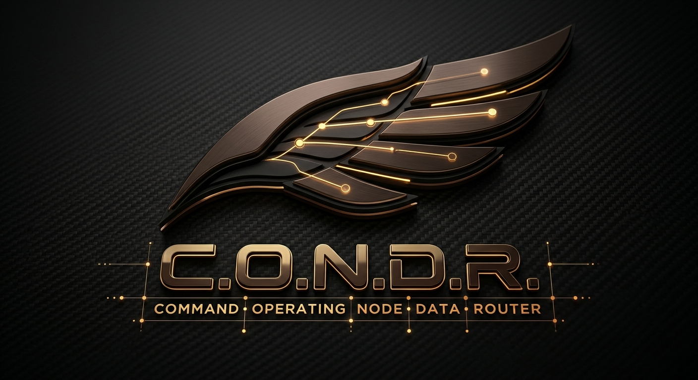
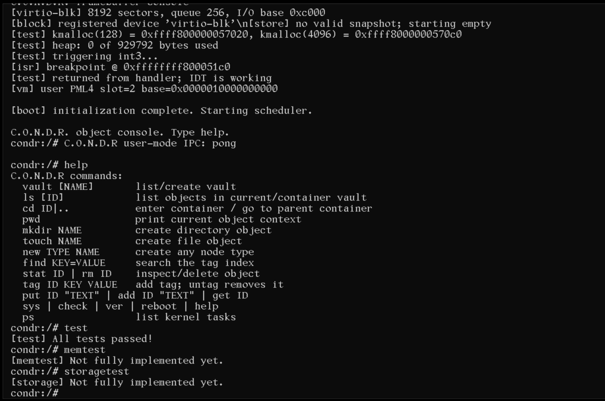

<p align="center">
  
</p>


[](https://github.com/Ghostoraner/C.O.N.D.R/actions/workflows/build.yml)[](https://://github.comGhostoraner/C.O.N.D.R)


[](https://://github.comGhostoraner/C.O.N.D.R/commits/main)
[](LICENSE)


# C.O.N.D.R.

**Command Operating Node Data Router** is an experimental 64-bit x86 operating
system written in freestanding C++23 and NASM. It boots through Limine on BIOS
and UEFI systems.

> This is an early hobby OS, not a secure or production-ready system. The shell
> runs in kernel mode.

## Features

- Limine boot, x86_64 entry point, GDT, IDT and interrupt stubs

- Remapped 8259 PIC, 100 Hz PIT ticks and interrupt-driven PS/2 input queue

- Timer-preemptive single-CPU kernel task scheduler with independent stacks (`nord::arch::scheduler`); the task index grows on demand and task records come from a configurable slab cache

- Process lifecycle with `ready`/`running`/`blocked`/`zombie` states, `exit(status)` and `wait`, plus full address-space, page and kernel-stack reclamation

- Blocking `ipc_receive`, `read_char` and `sleep_ms`: tasks park in `blocked` and wake on IPC traffic, keyboard IRQs or PIT deadlines instead of busy-waiting

- Ring 3 user tasks with per-process address spaces and an ELF64 loader

- NVMFS-backed `spawn(path, argv, envp)`: loads an ELF64 file from storage and builds a System V AMD64 initial stack with argv, envp and an auxiliary vector

- NX page protections for user data/stack pages, plus guard pages below kernel and user task stacks

- Demand-paged user memory: `brk` and anonymous `mmap` backed by a Ring 3 page-fault handler, with fault-safe `copy_from_user`/`copy_to_user` validation

- Stable exception reports with register dumps, frame-pointer call stacks, and ELF symbol lookup

- Physical page allocator, kernel heap, and virtual memory management

- 32-bit Limine framebuffer with a 12x22 console font

- PS/2 keyboard input and framebuffer command console

- User-mode keyboard input: a single user task can take keyboard focus, read characters with a blocking syscall, and return focus to the console; stack-backed waiter lists let an unbounded number of readers wait at once

- 32-bit `NodeId` (`u32`) architecture integrated across IPC, capability rights, and NVMFS storage handles

- Dynamically sized NVMFS node and tag registries backed by the kernel heap instead of fixed tables

- Preemption-safe spinlocks around PMM, NVMFS, and IPC state; every IPC connection gets its own endpoint pair

- Block device abstraction layer (`BlockDevice`) with VirtIO-blk driver registration

- Two-slot NVMFS snapshot mechanism with CRC persistence over block devices

- Kernel-level automated unit testing framework (`kernel/test/`) covering PMM and heap boundary cases, address spaces and `brk`/`mmap` demand paging, scheduler growth and blocking sleep, process lifecycle and reclamation, NVMFS registry growth, IPC queue saturation and blocking receive, snapshot corruption rejection, keyboard queue, scalable waiter list, full `read_char` block/wake cycle and focus rules

- Freestanding command tokenizer with quoted arguments


## Build and run

Required tools: `g++` with C++23 support, `ld`, `nasm`, `make`, `git`,
`python3`, `qemu-system-x86_64`, and either `xorriso` or `genisoimage`. A dedicated
`x86_64-elf` cross-compiler is recommended; the Makefile falls back to the
host compiler and linker.

```sh
make            # build/condr.elf
make iso        # build/condr.iso (clones Limine on first use)
make usb-iso    # build/condr-usb.iso, hybrid BIOS/UEFI image (requires xorriso)
make run        # boot C.O.N.D.R. in QEMU
make debug      # boot QEMU paused for GDB
```

Click the QEMU window to give the guest keyboard focus. `Ctrl+Alt+3` switches to
the COM1 serial console; `Ctrl+Alt+1` returns to the framebuffer. Press `Ctrl+C`
in the launching terminal to stop QEMU.

For USB writing instructions and firmware notes, see [docs/USB_BOOT.md](docs/USB_BOOT.md).
The upcoming kernel milestones are tracked in [docs/ROADMAP.md](docs/ROADMAP.md).

## NVMFS & Storage

NVMFS means **Node Vector Memory File System**. It is a flat registry of typed
objects, not a pathname-based filesystem. Each node has a 32-bit ID (`u32`), type, name,
optional container ID and a byte stream. Tags are stored in a separate fixed
index and queried by key/value. `vault` and `directory` nodes can contain other
objects, but there are no POSIX paths.

Persistence is handled via a two-slot snapshot mechanism with CRC validation utilizing the abstract `BlockDevice` layer (backed by VirtIO-blk).

At boot the kernel installs a small `args` ELF program into NVMFS, so
`spawn args alpha beta` exercises the storage-backed ELF loader and the System V
initial stack.

## Console

The guest uses short, object-oriented commands rather than POSIX commands:

| Command | Action |
| --- | --- |
| `vault [NAME]` | List vaults or create one |
| `ls [ID]` | List the current container or a container ID |
| `cd ID`, `cd ..` | Enter a vault/directory object or return to its container |
| `pwd` | Show the current object context |
| `mkdir NAME`, `touch NAME` | Create directory/file objects in the current container |
| `new TYPE NAME` | Create a `file`, `directory`, `vault`, `device` or `process` node |
| `find KEY=VALUE` | Find objects through the tag index |
| `stat ID`, `rm ID` | Inspect or delete an object |
| `tag ID KEY VALUE`, `untag ID KEY VALUE` | Add or remove a tag |
| `put ID "TEXT"`, `add ID "TEXT"`, `get ID` | Replace, append or read a stream |
| `sync` | Write the current NVMFS snapshot to disk |
| `kbd-demo` | Launch the keyboard reader demo on demand |
| `spawn PATH [ARGS...]` | Load an ELF file from NVMFS, run it with arguments and wait for its status |
| `test` | Run automated kernel unit test suite |
| `memtest` | Execute memory and heap subsystem checks |
| `storagetest` | Test block device storage and snapshots |
| `sys`, `check`, `ver`, `reboot`, `help` | Status, self-test, version, reboot and help |
| `ps` | List kernel tasks and context-switch counts |

Example session on a fresh boot:

```text
vault research
cd 1
touch "boot notes"
ls
tag 2 topic kernel
find topic=kernel
put 2 "Limine enters the kernel"
get 2
stat 2
test
sys
```

IDs are monotonically assigned during each boot, so example IDs change after
creating or deleting objects. The tokenizer supports single and double quotes.

## User-mode syscalls

User programs enter the kernel with `int 0x80`. The number goes in `RAX`.

| No. | Name | Action |
| --- | --- | --- |
| 1 | `write` | Print a buffer to the console |
| 2 | `exit` | Terminate the calling task with the `RDI` status |
| 3 | `service_register` | Register an IPC service by name |
| 4 | `service_connect` | Connect to a named IPC service |
| 5 | `service_accept` | Accept an incoming connection |
| 6 | `ipc_send` | Send a message on a handle |
| 7 | `ipc_receive` | Block until a message arrives on a handle |
| 8 | `read_char` | Block until one character arrives; requires keyboard focus |
| 9 | `kbd_focus` | `RDI != 0` takes keyboard focus, `RDI == 0` returns it to the console |
| 10 | `wait` | Wait for a child (`RDI` pid, `<= 0` for any) and collect its status |
| 11 | `sleep_ms` | Sleep for `RDI` milliseconds, waking on a PIT tick |
| 12 | `spawn` | Load an ELF file from NVMFS (`RDI` path, `RSI` argv, `RDX` envp) and return the child pid |
| 13 | `brk` | Set the program break (`RDI`; `0` queries it) |
| 14 | `mmap` | Create anonymous demand-zero pages (`RDI` hint, `RSI` length, `RDX` prot, `R10` flags) |

`exit` leaves a zombie record until the parent calls `wait`, which reclaims the
child's address space, pages, kernel stack and task record. Tasks with no living
parent are reclaimed automatically. `read_char` returns `1` on success, `-1` for
an invalid buffer and `-11` when the caller does not hold focus. While a user
task holds focus, console input is suspended. Focus is released automatically
when the task exits. `ipc_receive` and `sleep_ms` block until a message arrives
or a PIT deadline expires; no syscall busy-waits for its wakeup.

`spawn` loads an ELF64 file from a flat NVMFS name and returns the child pid.
The kernel builds the System V AMD64 initial stack (`argc`, `argv`, `envp`, and
an auxv ending in `AT_NULL`) before entering Ring 3.

`brk` and `mmap` manage a private demand-paged user region. The first access to
a page raises a page fault; the kernel allocates a zero-filled page, applies the
mapping permissions and retries the instruction. `copy_from_user` and
`copy_to_user` walk the current address space, resolve demand-zero pages and
enforce write access, so an invalid pointer returns an error instead of
faulting the kernel. The built-in `mem` program exercises this path; run it with
`spawn mem`.

The `kbd-demo` program (`user/kbd_demo.asm`) shows the flow: it takes focus,
reads five characters, echoes them, and returns focus to the console. It is not
started automatically; run it from the console with `kbd-demo`.

## Debugging

Run `make debug`, then in another terminal run:

```sh
./scripts/gdb-attach.sh
```

## Screenshots

<p align="center">
  
</p>
<p align="center">
  <em>Kernel initialization, VirtIO-blk registration, and console command execution.</em>
</p>

## License

The C.O.N.D.R. source code is offered under the MIT License; see `LICENSE`.
The embedded `LatGrkCyr-12x22` console font is a separate third-party asset
licensed under GPL-2.0. Its source and attribution are documented in
`THIRD_PARTY_NOTICES.md`.

See [CONTRIBUTING.md](CONTRIBUTING.md) for contribution guidelines and
[SECURITY.md](SECURITY.md) for vulnerability reporting.

[](https://gitdiagram.com/ghostoraner/c.o.n.d.r?utm_source=readme&utm_medium=picture)

---

# C.O.N.D.R. (Русский)

**Command Operating Node Data Router** — экспериментальная 64-битная ОС для
x86, написанная на freestanding C++23 и NASM. Загружается через Limine в BIOS
и UEFI.

> Это ранний hobby-проект, не предназначенный для безопасной или промышленной
> эксплуатации. Shell работает в режиме ядра.

## Возможности

* Загрузка Limine, точка входа x86_64, GDT, IDT и обработчики прерываний
* Переназначенный PIC 8259, тики PIT 100 Гц и очередь ввода PS/2 через IRQ
* Однопроцессорный планировщик задач ядра с вытеснением по таймеру и отдельными стеками (`nord::arch::scheduler`); индекс задач растёт динамически, а записи задач берутся из настраиваемого slab-кэша
* Жизненный цикл процесса с состояниями `ready`/`running`/`blocked`/`zombie`, `exit(status)` и `wait`, а также полное освобождение адресного пространства, страниц и стека ядра

* Блокирующие `ipc_receive`, `read_char` и `sleep_ms`: задачи переходят в `blocked` и просыпаются по IPC, IRQ клавиатуры или дедлайну PIT без busy-wait
* Пользовательские задачи Ring 3 с собственными адресными пространствами и загрузчиком ELF64
* Поддержка `spawn(path, argv, envp)`: загрузка ELF64 из NVMFS и построение начального стека System V AMD64 с argv, envp и auxiliary vector
* NX-защита страниц данных и стека, guard-страницы под стеками задач ядра и пользователя
* Пользовательская память по требованию: `brk` и анонимный `mmap` через обработчик page fault Ring 3, плюс безопасная проверка `copy_from_user`/`copy_to_user`
* Стабильные отчёты об исключениях: дамп регистров, стек вызовов по frame pointer и имена функций из таблицы символов ELF
* Физический аллокатор страниц, куча ядра и управление виртуальной памятью
* Framebuffer Limine 32 bpp со шрифтом консоли 12x22
* Ввод с PS/2-клавиатуры и графическая командная консоль
* Ввод с клавиатуры для user mode: одна пользовательская задача может взять фокус клавиатуры, читать символы блокирующим syscall и вернуть фокус консоли; списки ожидания на стеке задач не ограничивают число читателей
* Архитектура 32-битных `NodeId` (`u32`), интегрированная в IPC, права возможностей и хранилище NVMFS

* Динамические реестры узлов и тегов NVMFS на куче ядра вместо фиксированных таблиц

* Спинлоки с отключением вытеснения вокруг PMM, NVMFS и состояния IPC; каждое IPC-соединение получает собственную пару endpoint'ов
* Абстракция блочных устройств (`BlockDevice`) с регистрацией драйвера VirtIO-blk
* Двухслотовый механизм снапшотов NVMFS с защитой CRC поверх блочного слоя
* Модуль автоматического юнит-тестирования ядра (`kernel/test/`) для граничных случаев PMM и кучи, адресных пространств и demand paging `brk`/`mmap`, роста планировщика и блокирующего сна, жизненного цикла и освобождения процессов, роста NVMFS, переполнения очередей IPC и блокирующего приёма, отказа от повреждённых снапшотов, очереди клавиатуры, масштабируемого списка ожидания, полного цикла блокировки/пробуждения `read_char` и правил фокуса
* Freestanding-токенизатор команд с поддержкой аргументов в кавычках

## Сборка и запуск

Нужны `g++` с поддержкой C++23, `ld`, `nasm`, `make`, `git`,
`qemu-system-x86_64` и `xorriso` либо `genisoimage`. Рекомендуется отдельный
кросс-компилятор `x86_64-elf`; Makefile умеет использовать host compiler/linker.

```sh
make            # сборка build/condr.elf
make iso        # сборка build/condr.iso (при первом запуске клонируется Limine)
make usb-iso    # сборка build/condr-usb.iso, hybrid BIOS/UEFI (нужен xorriso)
make run        # запуск C.O.N.D.R. в QEMU
make debug      # запуск QEMU с паузой для GDB
```

Щёлкни по окну QEMU, чтобы передать клавиатуру гостевой системе. `Ctrl+Alt+3`
переключает на serial-консоль COM1, `Ctrl+Alt+1` возвращает framebuffer.
Остановить QEMU можно через `Ctrl+C` в терминале запуска.

Инструкция по записи на USB и примечания по прошивкам: [docs/USB_BOOT.md](docs/USB_BOOT.md).
Следующие этапы разработки ядра: [docs/ROADMAP.md](docs/ROADMAP.md).

## NVMFS и Хранилище

NVMFS расшифровывается как **Node Vector Memory File System**. Это плоский
реестр типизированных объектов, а не файловая система с путями. У узла есть
32-битный ID (`u32`), тип, имя, необязательный ID контейнера и поток байтов. Теги
хранятся в отдельном фиксированном индексе и ищутся по паре ключ/значение.
Узлы `vault` и `directory` могут содержать другие объекты, но POSIX-путей нет.

Персистентность обеспечивается двухслотовым механизмом снапшотов с проверкой CRC через абстракцию `BlockDevice` (на базе VirtIO-blk).

При загрузке ядро устанавливает в NVMFS небольшую ELF-программу `args`, поэтому
`spawn args alpha beta` проверяет загрузчик из хранилища и начальный стек System V.

## Командная консоль

Используются короткие объектные команды, а не POSIX-команды:

| Команда | Действие |
| --- | --- |
| `vault [NAME]` | Показать vault-объекты или создать vault |
| `ls [ID]` | Показать объекты текущего контейнера или указанного ID |
| `cd ID`, `cd ..` | Войти в vault/directory или вернуться в контейнер-родитель |
| `pwd` | Показать текущий контекст объектов |
| `mkdir NAME`, `touch NAME` | Создать directory/file-объект в текущем контейнере |
| `new TYPE NAME` | Создать узел типа `file`, `directory`, `vault`, `device` или `process` |
| `find KEY=VALUE` | Найти объекты через теговый индекс |
| `stat ID`, `rm ID` | Показать или удалить объект |
| `tag ID KEY VALUE`, `untag ID KEY VALUE` | Добавить или удалить тег |
| `put ID "TEXT"`, `add ID "TEXT"`, `get ID` | Заменить, дописать или прочитать поток |
| `sync` | Записать текущий снапшот NVMFS на диск |
| `kbd-demo` | Запустить демонстрацию чтения клавиатуры по требованию |
| `spawn PATH [ARGS...]` | Загрузить ELF из NVMFS, запустить с аргументами и дождаться статуса |
| `test` | Запустить набор автоматических юнит-тестов ядра |
| `memtest` | Выполнить проверки подсистемы памяти и кучи |
| `storagetest` | Проверить блочное хранилище и снапшоты |
| `sys`, `check`, `ver`, `reboot`, `help` | Статус, самопроверка, версия, перезагрузка и помощь |
| `ps` | Список kernel-задач и число переключений контекста |

Пример с чистой загрузки:

```text
vault research
cd 1
touch "boot notes"
ls
tag 2 topic kernel
find topic=kernel
put 2 "Limine enters the kernel"
get 2
stat 2
test
sys
```

ID назначаются последовательно во время загрузки, поэтому примерные значения
меняются после создания или удаления объектов. Токенизатор поддерживает
одинарные и двойные кавычки.

## Системные вызовы для user mode

User-программы входят в ядро через `int 0x80`. Номер вызова передаётся в `RAX`.

| №  | Имя | Действие |
| --- | --- | --- |
| 1 | `write` | Вывести буфер в консоль |
| 2 | `exit` | Завершить вызывающую задачу со статусом из `RDI` |
| 3 | `service_register` | Зарегистрировать IPC-сервис по имени |
| 4 | `service_connect` | Подключиться к IPC-сервису по имени |
| 5 | `service_accept` | Принять входящее подключение |
| 6 | `ipc_send` | Отправить сообщение по дескриптору |
| 7 | `ipc_receive` | Ждать сообщение по дескриптору |
| 8 | `read_char` | Ждать один символ; требует фокуса клавиатуры |
| 9 | `kbd_focus` | `RDI != 0` берёт фокус клавиатуры, `RDI == 0` возвращает его консоли |
| 10 | `wait` | Ждать дочернюю задачу (`RDI` pid, `<= 0` — любую) и получить статус |
| 11 | `sleep_ms` | Спать `RDI` миллисекунд, просыпаясь по тику PIT |
| 12 | `spawn` | Загрузить ELF из NVMFS (`RDI` путь, `RSI` argv, `RDX` envp) и вернуть pid ребёнка |
| 13 | `brk` | Установить границу программы (`RDI`; `0` — запрос текущей) |
| 14 | `mmap` | Создать анонимные страницы по требованию (`RDI` подсказка, `RSI` длина, `RDX` prot, `R10` flags) |

`exit` оставляет zombie-запись, пока родитель не вызовет `wait`; тот освобождает
адресное пространство, страницы, стек ядра и запись задачи. Задачи без живого
родителя освобождаются автоматически. `read_char` возвращает `1` при успехе,
`-1` при неверном буфере и `-11`, если вызывающая задача не владеет фокусом.
Пока user-задача держит фокус, ввод в консоль приостановлен. Фокус снимается
автоматически при завершении задачи. `ipc_receive` и `sleep_ms` блокируют
задачу до прихода сообщения или тика PIT соответственно.

`spawn` загружает ELF64 из плоского имени NVMFS и возвращает pid ребёнка. Ядро
строит начальный стек System V AMD64 (`argc`, `argv`, `envp` и auxv с
терминатором `AT_NULL`) перед переходом в Ring 3.

`brk` и `mmap` управляют приватной пользовательской памятью по требованию.
Первое обращение к странице вызывает page fault; ядро выделяет заполненную
нулями страницу, применяет права отображения и повторяет инструкцию.
`copy_from_user` и `copy_to_user` обходят адресное пространство, материализуют
страницы `brk`/`mmap` и проверяют право записи, поэтому неверный указатель
возвращает ошибку, а не роняет ядро. Встроенная программа `mem` проверяет этот
путь; запусти её командой `spawn mem`.

Программа `kbd-demo` (`user/kbd_demo.asm`) показывает весь сценарий: берёт
фокус, читает пять символов, повторяет их и возвращает фокус консоли. Она не
запускается автоматически; запусти её из консоли командой `kbd-demo`.

## Отладка

Выполни `make debug`, затем в другом терминале:

```sh
./scripts/gdb-attach.sh
```

## Скриншоты

<p align="center">
  
</p>
<p align="center">
  <em>Инициализация ядра, регистрация VirtIO-blk и выполнение команд в консоли.</em>
</p>

## Лицензия

Исходный код C.O.N.D.R. распространяется по лицензии MIT; см. `LICENSE`.
Встроенный шрифт `LatGrkCyr-12x22` — отдельный сторонний ресурс под GPL-2.0.
Источник и атрибуция указаны в `THIRD_PARTY_NOTICES.md`.

Правила участия описаны в [CONTRIBUTING.md](CONTRIBUTING.md), а порядок
сообщения об уязвимостях — в [SECURITY.md](SECURITY.md).

[](https://gitdiagram.com/ghostoraner/c.o.n.d.r?utm_source=readme&utm_medium=picture)